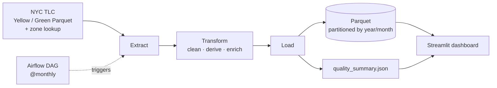

# NYC Taxi ETL: Spark, Airflow & Streamlit

Batch ETL pipeline in **Scala + Apache Spark** that turns raw NYC TLC Yellow and Green taxi trip records into clean, enriched, partitioned Parquet, with a **Streamlit** analytics dashboard on top and an optional **Airflow** DAG for monthly scheduling.


## What it does

- **Extracts** raw Yellow/Green trip Parquet files and the TLC zone lookup table.
- **Cleans and validates** trips with explicit data-quality rules, and flags suspicious rows instead of silently dropping them.
- **Enriches** each trip with trip duration, tip percentage, day of week, hour of day, and pickup/dropoff borough and zone names.
- **Loads** the result into Parquet partitioned by `year`/`month`. Re-running a month replaces only that month (idempotent).
- **Reports** data quality: raw vs. clean row counts and the share of dropped and suspicious rows, written to `data/quality_summary.json`.
- **Serves** a multi-page dashboard: revenue, demand, tipping behaviour, and data quality.

## Architecture



The Spark job runs in local mode (`local[*]`) on a single JVM. Airflow and Streamlit never talk to each other: Airflow's job ends when `data/output/` and the quality summary are written, and Streamlit reads whatever is on disk at that moment.

## Data-quality rules

| Rule | Action |
|---|---|
| `fare_amount <= 0` | Drop |
| Dropoff not after pickup | Drop |
| `passenger_count = 0` (null is kept) | Drop |
| Missing pickup or dropoff location ID | Drop |
| `trip_distance = 0` with `fare_amount > 0` | Keep, flag as `is_suspicious_zero_distance` (flat-rate or cancelled-but-charged trips are plausible) |

These rules are covered by 7 ScalaTest cases in `src/test/scala/etl/TransformSpec.scala`.

## Orchestration

The Airflow DAG (`orchestration/dags/nyc_taxi_monthly_dag.py`, `@monthly`) wraps the ETL:

```
discover_available_month   HEAD request: has the TLC published this month?
        ↓
skip_if_already_processed  skip if the partition already exists
        ↓
[download_yellow, download_green, download_zone_lookup]   parallel
        ↓
run_etl                    sbt run
        ↓
validate_output            fail if more than 20% of rows were dropped
        ↓
notify
```

Airflow is optional: the ETL and the dashboard run fine without it.

## Tech stack

| Layer | Tool |
|---|---|
| ETL | Apache Spark 3.5.1 (DataFrame API), Scala 2.12.18 |
| Build / tests | sbt, ScalaTest 3.2.19 |
| Storage | Parquet, partitioned by `year`/`month` |
| Orchestration | Apache Airflow |
| Dashboard | Streamlit, Plotly, pandas |

## Quickstart

**Prerequisites:** JDK 17+, sbt, Python 3.9+.

1. Download one month of data from the [TLC trip record page](https://www.nyc.gov/site/tlc/about/tlc-trip-record-data.page):
   ```
   data/raw/yellow/                 Yellow trip Parquet file(s)
   data/raw/green/                  Green trip Parquet file(s)
   data/raw/taxi_zone_lookup.csv    zone lookup
   ```
2. Run the pipeline:
   ```bash
   sbt run
   ```
   Output goes to `data/output/` plus `data/quality_summary.json`. Paths can be overridden: `sbt "run <yellow> <green> <zones> <output> <summary>"`.
3. Run the tests:
   ```bash
   sbt test
   ```
4. Launch the dashboard:
   ```bash
   cd dashboard
   pip install -r requirements.txt
   streamlit run app.py
   ```

## Project structure

```
src/main/scala/etl/
  Main.scala         entry point: Extract → Transform → Load, prints row counts
  Extract.scala      reads raw Parquet and the zone lookup CSV
  Transform.scala    cleaning rules, derived columns, zone enrichment
  Load.scala         partitioned Parquet write + quality summary
  models/Trip.scala  unified trip schema
src/test/scala/etl/  ScalaTest specs for the cleaning rules
dashboard/           Streamlit app (Overview, Revenue, Demand, Tipping, Data Quality)
orchestration/dags/  Airflow DAG
data/                raw input and output (git-ignored)
```

## Design notes

- **Dynamic partition overwrite.** Spark's default `overwrite` wipes the whole output path. `spark.sql.partitionOverwriteMode=dynamic` limits it to the `year`/`month` partitions being written, so re-running a month is safe.
- **Flag, don't drop, ambiguous rows.** Zero-distance trips with a fare are kept and marked, so the dashboard can show how many there are.
- **Local mode is a deliberate scope limit.** A production version would run on a cluster (Spark on Kubernetes or YARN); the code itself would not change.

## Limitations

- Only the cleaning rules are unit-tested; Extract, Load and the dashboard are not.
- No benchmark numbers are published yet. Row counts and drop rates depend on the month you load and are shown in the dashboard's Data Quality page.

## Data source

NYC Taxi & Limousine Commission (TLC) trip record data, publicly available at the link above.
